# 🎨 UI Enhancement Report — Arabic OCR Review Tool
> **Status:** Live Code-Level CSS & HTML Audit  
> **Method:** Exhaustive source code analysis (`frontend/css/*.css`, `frontend/*.html`, `frontend/js/**/*.js`)  
> **Scope:** Every screen and component in the application

---

## How to Read This Report

Each section = one screen. Each subsection = a specific problem + a concrete fix.  
Colour-coded by effort/priority:

| Label | Meaning |
|---|---|
| 🔴 **Critical** | Broken UX flow or accessibility blocker |
| 🟠 **High** | Significant friction; fix in Sprint 1 |
| 🟡 **Medium** | Noticeable gap; fix in Sprint 2 |
| 🟢 **Polish** | Craft/delight; fix in Sprint 3+ |

---

## Screen 1 — Home (`index.html`)

### Current State
- Large centred hero dropzone + 3 action cards (New Project · Projects · Settings) + recent projects list.
- Design tokens in place: emerald-teal primary (`#0f766e`), slate text, clean sans-serif.

### Issues & Fixes

#### 🟠 UI-H1 · No App Identity / Branding
**Problem:** The page has no logo, app name badge, or version indicator. The `<h1>` says "مرحبًا بكم في أداة معالجة ومراجعة النصوص" — a long sentence, not an identity.  
**Fix:** Add a compact top-left app header bar: `[📖 icon] Arabic OCR · v2.x` with a subtle teal left border. Keep it slim (40px) so it doesn't eat vertical space.

#### 🟠 UI-H2 · Dropzone and Cards are Redundant (Duplication)
**Problem:** "New Project" appears three times: as the dropzone, as the first card, and in the hero `<h1>`. The cards feel decorative rather than functional.  
**Fix:** Remove the separate "New Project" card. Promote the dropzone to be the full hero CTA. Keep only "Browse Projects" and "Settings" as secondary actions below it. This reduces visual noise and makes the primary action unmistakably clear.

#### 🟡 UI-H3 · Recent Projects List is Underdesigned
**Problem:** The recent projects section `#recent-projects` renders as plain text rows with no thumbnail, status badge, or last-modified date.  
**Fix:** Render each recent project as a **compact horizontal card**: `[thumb 48×64] | Title · Author | N pages · Last opened: 3h ago | [Open →]`. Use `thumbs/page_0.jpg` for the thumbnail.

#### 🟡 UI-H4 · No Dark Mode on Landing Page
**Problem:** `index.html` does not apply the theme toggle — it's buried in `review.html`. The home page always renders in light mode.  
**Fix:** Move `<button id="btn-toggle-theme">` into the app header bar (see UI-H1). Wire it via `theme.js` on all pages.

#### 🟢 UI-H5 · Hero Dropzone Hover State Uses `transition: all`
**Problem:** `home.css` line 40 — `.hero-dropzone { transition: all var(--trans-normal) }`. Animating `all` triggers layout on every property change (expensive, can cause jank).  
**Fix:** Replace with `transition: border-color 200ms ease, background-color 200ms ease, box-shadow 200ms ease, transform 200ms ease`.

---

## Screen 2 — Projects List (`projects.html`)

### Issues & Fixes

#### 🟠 UI-P1 · No Visual Status at a Glance
**Problem:** Project cards likely show just title + page count. There is no indicator of how far along each project is (% reviewed, OCR complete, etc.).  
**Fix:** Add a thin progress bar at the bottom of each card: `████░░░░ 48% reviewed`. Colour: teal fill on `--color-bg-muted` track.

#### 🟠 UI-P2 · No Search / Filter on Projects List
**Problem:** A user with 20+ projects has no way to filter by name, date, or status.  
**Fix:** Add a search input at the top of the list: `🔍 Search projects…`. Filter in-place (no backend needed — pure JS on loaded project data).

#### 🟡 UI-P3 · No Sort Controls
**Problem:** Projects appear in creation order only.  
**Fix:** Add a compact sort bar: `Sort: [Last opened ▾] [A–Z] [Pages ↓]`.

#### 🟡 UI-P4 · Card Context Menu (Right-Click)
**Problem:** To delete or rename a project, users must navigate into project settings.  
**Fix:** Right-click (or ⋮ menu) on a card → `Rename · Duplicate · Delete · Export All`.

---

## Screen 3 — Project Dashboard (`project-dashboard.html`)

### Current State
- Pipeline stepper (5 steps) · LAN status bar · Stats container · Page grid/table switcher.
- Lots of inline `style=""` attributes instead of CSS classes — makes theming and dark mode very hard.

### Issues & Fixes

#### 🔴 UI-D1 · Inline Styles Everywhere — Dark Mode Impossible
**Problem:** Nearly every layout element in `project-dashboard.html` uses `style="display: flex; ..."` hardcoded directly in HTML. These override any CSS token-based dark mode rule.  
**Fix:** Extract all inline styles to named CSS classes in a new `dashboard.css`. This is a prerequisite for dark mode (G-1 from the roadmap).

#### 🟠 UI-D2 · Pipeline Stepper Has No Progress Feedback
**Problem:** The 5-step stepper (Preprocess → OCR → Layout → Review → Export) uses `active` class but doesn't show completion state per step. If the user has OCR'd but not reviewed, all steps look the same.  
**Fix:** Add CSS states: `.pipeline-step.done` (teal ✓ circle) · `.pipeline-step.active` (filled primary) · `.pipeline-step.locked` (grey). Compute from project stats automatically.

#### 🟠 UI-D3 · LAN Panel is Always Visible Even When Unused
**Problem:** The LAN/collaboration bar occupies ~52px of vertical space on every project, even for solo users who never use LAN.  
**Fix:** Collapse it by default into a 1-line toggle: `🔗 Local Network Sharing — Off [Enable]`. Expand only when user clicks or when LAN is active.

#### 🟠 UI-D4 · Page Thumbnails Have No OCR Status Overlay
**Problem:** Page grid shows thumbnails but no indicator of whether that page has been OCR'd, reviewed, or has errors.  
**Fix:** Overlay a bottom-edge status strip on each thumbnail card:
- Grey = not started
- Yellow = OCR done, not reviewed
- Teal = reviewed/complete
- Red = OCR error

#### 🟡 UI-D5 · "Select All" Checkbox is Lost in the Controls Row
**Problem:** The select-all checkbox is a plain `<label>` + `<input>` with no visual prominence.  
**Fix:** Style it as a small toggle button. Add a "Bulk Actions" dropdown that appears when ≥1 pages are selected: `[OCR Selected] [Export Selected] [Delete Selected]`.

#### 🟡 UI-D6 · Stats Container is a Black Box
**Problem:** `#dashboard-stats-container` renders stats injected by JS but has no skeleton/loading state. First load feels like nothing happened.  
**Fix:** Add a CSS skeleton shimmer for the stats row while data loads.

---

## Screen 4 — Review Studio (`review.html`)

### Current State
- 3-zone split: left sidebar (blocks list) · central crop viewer · top toolbar.
- Already has resizable panels (`panel-resize-handle`) and a theme toggle button.
- Toolbar has: page nav · thumb preview · undo/redo · save · text preview · dashboard · integrity audit · font zoom · theme · tracking settings.

### Issues & Fixes

#### 🔴 UI-R1 · Toolbar is Overloaded — Cognitive Overflow
**Problem:** The single toolbar row holds 15+ elements. On narrower windows it wraps into two rows due to `flex-wrap: wrap`, causing layout shift and covering content.  
**Fix:** Split into two logical groups:
1. **Navigation bar** (top, fixed): page nav · thumb · page progress pill
2. **Action bar** (second row): undo/redo/save · separator · text preview · dashboard · integrity · separator · font zoom · theme
- Move "Tracking" settings into a dedicated sidebar panel or the right-click context menu.

#### 🔴 UI-R2 · No Visual Indication of Unsaved Changes
**Problem:** When a user edits a block and hasn't saved yet, there is no asterisk, dirty indicator, or autosave countdown visible.  
**Fix:** Show a subtle `● Unsaved changes — Ctrl+S to save` pill in the navigation bar when dirty. Autosave after 30 seconds of inactivity (configurable).

#### 🟠 UI-R3 · Block List Cards Have No Type Colour Coding at a Glance
**Problem:** Block type categories have token colours defined (`--cat-title`, `--cat-text`, etc.) but block list cards in the sidebar are uniformly styled. The user must read the type label to distinguish a Title from a Footnote.  
**Fix:** Add a 3px left accent border to each block card using the category token colour. This provides instant visual scanning without reading.

#### 🟠 UI-R4 · No Page Filmstrip / Quick Jump
**Problem:** To jump from page 5 to page 50, the user must type a page number. No visual thumbnail strip exists.  
**Fix:** Add a collapsible bottom filmstrip (this is G-4 in the roadmap). Each thumbnail 60×80px; click to jump; current page highlighted with a teal border. Keyboard: `Alt+←/→` to step.

#### 🟠 UI-R5 · No Global Search Visible from Review
**Problem:** There is no way to search for text across the whole project from Review Studio.  
**Fix:** `Ctrl+F` opens a slide-down search bar at the top of the blocks list panel. Results highlight matching blocks; `↵` jumps to next match; `Esc` closes.

#### 🟡 UI-R6 · Crop Viewer Has No Context — Which Block is Shown?
**Problem:** The crop viewer shows an image crop but doesn't indicate which block number or what type it is.  
**Fix:** Add a small label above the crop viewer: `Block 3 of 12 · Paragraph` with arrows `‹ ›` to step through blocks without clicking the list.

#### 🟡 UI-R7 · Block Text Editor is a Plain `<textarea>`
**Problem:** Text blocks are `<textarea>` elements with no inline formatting support.  
**Fix:** Progressively upgrade to `contenteditable` with a floating mini-toolbar on selection (B · I · U · font size) — this is G-5 in the roadmap. Keep `<textarea>` as fallback for plain-text mode.

#### 🟡 UI-R8 · Undo/Redo Buttons Have No Stack Depth Indicator
**Problem:** User doesn't know how many actions they can undo.  
**Fix:** Show a small badge on the undo button: `↩ 7` when 7 undo steps are available. Grey out when stack is empty.

#### 🟢 UI-R9 · Keyboard Shortcut Discoverability is Zero
**Problem:** Shortcuts (Ctrl+S, Ctrl+Z etc.) exist but are only findable via HTML `title` tooltips.  
**Fix:** Add a `?` button that opens a keyboard shortcut cheat-sheet modal. List: navigation, editing, block type assignment (1–9 keys), search, etc.

---

## Screen 5 — Preprocessing Studio (`preprocessing.html`)

### Issues & Fixes

#### 🟠 UI-PP1 · 6-Stage Wizard Has No Per-Stage Progress Indicator
**Problem:** The batch processing wizard applies stages across pages but gives no per-page or per-stage progress bar during processing.  
**Fix:** Show a live progress overlay: `Processing stage 3 of 6: Deskew — Page 14 of 87 ████████░░ 68%`.

#### 🟡 UI-PP2 · Before/After Split Curtain Needs Keyboard Control
**Problem:** The split-curtain slider for binarization comparison is mouse-only.  
**Fix:** When the slider has focus, `←/→` arrow keys move it 5% at a time.

#### 🟢 UI-PP3 · Deskew Fine-Angle Slider Has No Snap-to-Zero
**Problem:** Resetting the deskew angle to exactly 0.0° requires precise mouse control.  
**Fix:** Double-click the slider → snap to 0°. Show a "Reset" button that appears when angle ≠ 0.

---

## Screen 6 — Layout Editor (`layout-editor.html`)

### Issues & Fixes

#### 🟠 UI-LE1 · Canvas Has No Minimap for Large Pages
**Problem:** For high-res scans, the canvas requires heavy scrolling/panning to reach distant blocks.  
**Fix:** Add a minimap panel (G-8 from roadmap): a ÷10-scale thumbnail of the whole page in the bottom-right corner showing all block rectangles. Click to pan to that area.

#### 🟠 UI-LE2 · Block Selection Has No Multi-Select Visual
**Problem:** When multiple blocks are selected, it's unclear from visual design how many are selected or which ones.  
**Fix:** Selected blocks get a teal fill overlay at 20% opacity + a selection count badge in the top-right: `3 blocks selected`.

#### 🟡 UI-LE3 · Undo History Panel
**Problem:** The history module (`history.js`) exists but has no visible timeline in the UI.  
**Fix:** Add a small "History" sidebar tab: list of last 20 actions; click to jump to that state (like Photoshop history panel).

#### 🟢 UI-LE4 · Block Type Colour Legend is Missing
**Problem:** Blocks are colour-coded by type but there is no legend visible on the canvas.  
**Fix:** Show a compact legend in the bottom-left: `■ Title ■ Paragraph ■ Table ■ Footnote …` using category colours.

---

## Screen 7 — Export Studio (`export.html`)

### Current State
- Format cards grid + format-specific options panel.
- Inline styles in a `<style>` block inside the HTML file — not in a shared CSS file.

### Issues & Fixes

#### 🟠 UI-E1 · Format Cards Have No File-Size Estimates
**Problem:** User doesn't know if DOCX will be 500KB or 5MB before exporting.  
**Fix:** After format selection, show a rough estimate: `Estimated size: ~1.2 MB · 87 pages`.

#### 🟠 UI-E2 · No Export Progress / Cancel
**Problem:** When export is running, there is no visible progress bar and no way to cancel.  
**Fix:** Show a full-width progress bar below the export button: `Exporting DOCX — Page 34 of 87 ████████░░ 39% [Cancel]`.

#### 🟡 UI-E3 · Format-Specific Options are Hidden Behind Selection
**Problem:** The `.format-specific-options` panel only appears after selecting a format card. New users don't know DOCX has flowing vs. exact modes.  
**Fix:** Show a preview of key options below each card before selection — just 2–3 bullet points like `✓ RTL layout · ✓ Flowing mode · ✓ Poetry tables`.

#### 🟡 UI-E4 · No Export History
**Problem:** There is no log of past exports (when, what format, success/failure).  
**Fix:** Add a compact "Recent Exports" section at the bottom of the export page: `DOCX · Nov 18 11:30 · 87 pages · ✓ Success [Open file]`.

#### 🟢 UI-E5 · Inline Styles Should Move to Shared CSS
**Problem:** `export.html` has a `<style>` block with ~60 lines of CSS. These styles cannot be overridden by dark mode tokens.  
**Fix:** Move to `frontend/css/export.css`, link from `<head>`.

---

## Screen 8 — Settings (`settings.html`)

### Issues & Fixes

#### 🟠 UI-S1 · No Tab Structure / All Settings on One Scroll
**Problem:** All settings are on a single scrollable page with no grouping tabs.  
**Fix:** Organise into tabs: `General · OCR Engines · Export Defaults · Shortcuts · Appearance · About`.

#### 🟡 UI-S2 · API Key Inputs Show Plaintext on Hover
**Problem:** OCR API keys are stored and potentially displayed as plain text inputs.  
**Fix:** Use `type="password"` with a `👁 Show` toggle for all API key fields.

#### 🟡 UI-S3 · No "Reset to Defaults" per Section
**Problem:** If the user misconfigures something, reverting requires knowing the original value.  
**Fix:** Each settings section gets a small `↺ Reset section` link in its top-right corner.

#### 🟢 UI-S4 · About Section Missing
**Problem:** There is no visible version number, build info, or attribution anywhere in the app.  
**Fix:** Add an "About" tab: app name · version · GitHub link · license · credits.

---

## Cross-Cutting Issues (All Screens)

### 🔴 UI-X1 · No Dark Mode System
**Current:** `theme.js` exists and the Review page has a moon-icon toggle, but only Review applies it; home, dashboard, export, settings pages are always light.  
**Fix:** Dark mode token set in `tokens.css` under `[data-theme="dark"]` selector. Apply `data-theme` to `<html>` via `theme.js` on page load from `localStorage`. Add `prefers-color-scheme` media query as default fallback.

### 🔴 UI-X2 · Inline Style Attributes Break Theming
**Current:** `project-dashboard.html`, `export.html`, and `review.html` all use `style="..."` attributes for layout. Dark mode CSS cannot override inline styles without `!important`.  
**Fix:** Systematic refactor: replace all `style=""` layout attributes with named CSS classes. Prioritise dashboard and export pages.

### 🟠 UI-X3 · No App-Wide Navigation Bar
**Current:** Navigation relies on breadcrumbs + back buttons. There is no persistent sidebar or top bar that shows "where you are" in the app.  
**Fix:** Add a slim (48px) persistent left sidebar with icon navigation: `🏠 Home · 📁 Projects · ⚙️ Settings · 🌙 Theme`. Collapses to icons-only on narrow windows. This unifies navigation across all pages.

### 🟠 UI-X4 · No Loading Skeletons
**Current:** When data is loading (projects, page thumbnails, OCR results), the UI shows blank/empty areas with no feedback.  
**Fix:** CSS skeleton shimmer cards for all async data areas. Use `@keyframes shimmer { 0% { background-position: -400px 0 } 100% { background-position: 400px 0 } }` pattern.

### 🟡 UI-X5 · Toast Notifications Have No Queue / Persistence
**Current:** `notifications.js` exists but multiple rapid notifications likely stack/overwrite each other.  
**Fix:** Implement a notification queue: max 3 visible at once, oldest auto-dismisses after 4 seconds, error toasts stay until user dismisses.

### 🟡 UI-X6 · No Focus Ring / Keyboard Navigation
**Current:** Most buttons lack a visible focus ring (likely `:focus { outline: none }` somewhere in the CSS).  
**Fix:** Add `button:focus-visible { outline: 2px solid var(--color-primary); outline-offset: 2px; }` globally. Never suppress `:focus-visible`.

### 🟢 UI-X7 · `transition: all` Used Broadly
**Current:** Multiple components use `transition: all var(--trans-normal)`. This animates every property (even `height`, `width`, `padding`) causing layout thrash.  
**Fix:** Replace all `transition: all` with explicit property lists: `transition: background-color, border-color, box-shadow, transform`.

---

## Recommended Fix Sequence

```mermaid
flowchart LR
    subgraph Wave1["Wave 1 — Foundation (Unblock Dark Mode)"]
        X1["UI-X1 Dark Mode Tokens"]
        X2["UI-X2 Remove Inline Styles — Dashboard"]
        X3["UI-X3 Persistent Nav Sidebar"]
        D1["UI-D1 dashboard.css Extract"]
    end
    subgraph Wave2["Wave 2 — Core UX Friction"]
        H2["UI-H2 Simplify Home CTA"]
        R1["UI-R1 Split Review Toolbar"]
        R2["UI-R2 Unsaved Changes Indicator"]
        R3["UI-R3 Block Type Accent Borders"]
        D2["UI-D2 Pipeline Stepper States"]
        D4["UI-D4 Thumbnail Status Overlays"]
        E2["UI-E2 Export Progress Bar"]
    end
    subgraph Wave3["Wave 3 — Navigation & Power"]
        R4["UI-R4 Page Filmstrip"]
        R5["UI-R5 In-Review Search"]
        H3["UI-H3 Rich Recent Projects"]
        P1["UI-P1 Project Progress Bars"]
        S1["UI-S1 Settings Tabs"]
        LE1["UI-LE1 Canvas Minimap"]
    end
    subgraph Wave4["Wave 4 — Polish & Delight"]
        R7["UI-R7 Rich Text Toolbar"]
        R9["UI-R9 Shortcut Cheat Sheet"]
        X4["UI-X4 Skeleton Loaders"]
        X7["UI-X7 Fix transition:all"]
        PP3["UI-PP3 Deskew Snap-to-Zero"]
    end
    Wave1 --> Wave2 --> Wave3 --> Wave4
```

---

## Effort / Impact Matrix — UI Items Only

| ID | Issue | Screen | Impact | Effort |
|---|---|---|---|---|
| UI-X1 | Dark mode token system | All | ⭐⭐⭐⭐⭐ | Medium |
| UI-X2 | Remove inline styles | Dashboard | ⭐⭐⭐⭐ | Medium |
| UI-X3 | Persistent nav sidebar | All | ⭐⭐⭐⭐ | Medium |
| UI-R1 | Split overloaded toolbar | Review | ⭐⭐⭐⭐ | Low |
| UI-R2 | Unsaved changes indicator | Review | ⭐⭐⭐⭐ | Low |
| UI-R3 | Block type accent borders | Review | ⭐⭐⭐ | Low |
| UI-D2 | Pipeline stepper states | Dashboard | ⭐⭐⭐⭐ | Low |
| UI-D4 | Thumbnail status overlays | Dashboard | ⭐⭐⭐⭐ | Low |
| UI-H2 | Simplify home CTA | Home | ⭐⭐⭐ | Low |
| UI-R4 | Page filmstrip navigator | Review | ⭐⭐⭐⭐ | Low |
| UI-R5 | In-review global search | Review | ⭐⭐⭐⭐ | Low |
| UI-E2 | Export progress bar | Export | ⭐⭐⭐ | Low |
| UI-P1 | Project progress bars | Projects | ⭐⭐⭐ | Low |
| UI-S1 | Settings tab structure | Settings | ⭐⭐⭐ | Low |
| UI-R7 | Rich text editor | Review | ⭐⭐⭐⭐ | Medium |
| UI-X4 | Skeleton loaders | All | ⭐⭐⭐ | Medium |
| UI-LE1 | Canvas minimap | Layout Ed. | ⭐⭐⭐ | Low |
| UI-X7 | Fix `transition:all` | All | ⭐⭐ | Low |
